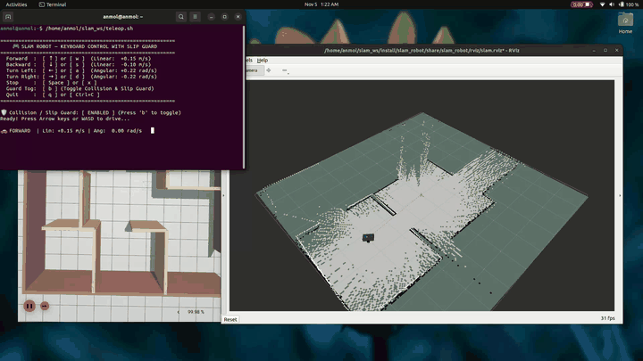
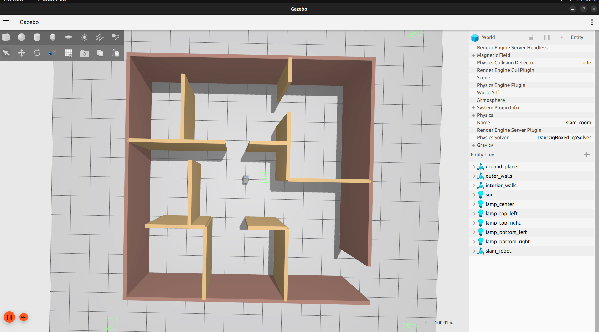
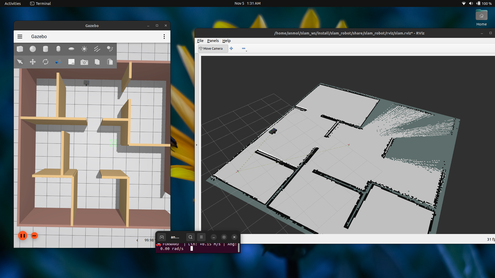
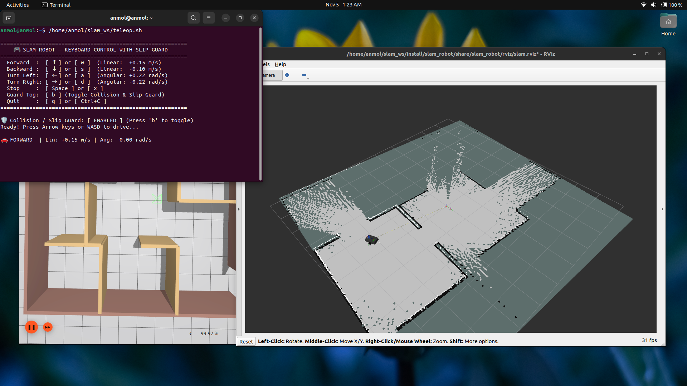
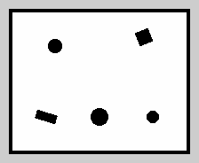
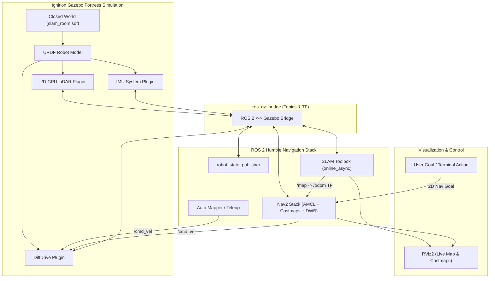

# 🤖 Autonomous SLAM & Navigation Mobile Robot

[](https://docs.ros.org/en/humble/)
[](https://gazebosim.org/)
[](https://github.com/SteveMacenski/slam_toolbox)
[](https://navigation.ros.org/)
[](https://python.org)
[](https://releases.ubuntu.com/22.04/)

A comprehensive, end-to-end **ROS 2 Humble** and **Ignition Gazebo Fortress** robotics project featuring a 2-wheel differential-drive mobile robot equipped with **2D LiDAR** and **IMU**. The robot performs real-time simultaneous localization and mapping (SLAM) using **SLAM Toolbox**, saves high-resolution occupancy grid maps, and navigates autonomously in complex indoor environments using the **Nav2** stack.

---

## 📸 Visual Demos & Simulation Previews

### 🎥 Autonomous Navigation Demo (Live Action)

> 📹 *Nav2 stack planning dynamic paths, avoiding obstacles, and driving to designated goal poses.*  
> *(Full resolution video available at [`docs/videos/navigation_demo.webm`](docs/videos/navigation_demo.webm))*

---

### 🖼️ Simulation & Visualization

| 🌐 Ignition Gazebo Fortress Simulation | 🗺️ Live SLAM Mapping in RViz2 |
| :---: | :---: |
|  |  |
| *Physics environment with 10x8m room & obstacles* | *SLAM Toolbox online async real-time mapping* |

| 🧭 Nav2 Global & Local Costmaps (RViz2) | 📄 Generated 2D Occupancy Grid Map |
| :---: | :---: |
|  |  |
| *AMCL localization, costmaps & DWB local planner* | *Final 0.05m/pixel resolution saved map* |

---

## 🌟 Key Features

- **🤖 Differential-Drive Robot URDF/Xacro**: Custom lightweight mobile base with dual drive wheels, front/rear caster wheels, 360° 2D LiDAR, and 6-DOF IMU sensor.
- **🗺️ Real-Time SLAM (SLAM Toolbox)**: Online asynchronous LiDAR-based mapping, pose-graph optimization, and loop closure detection.
- **🧭 Nav2 Autonomous Navigation**: Full integration of Nav2 bringup, AMCL particle-filter localization, global path planning (NavFn), local trajectory generation (DWB Controller), and costmaps.
- **⚡ 1-Click Launch Scripts**: Pre-configured bash scripts for simulation startup, teleoperation, automated mapping, goal navigation, and clean shutdown.
- **🏢 Custom Gazebo Simulation World**: 10m x 8m enclosed indoor room (`slam_room.sdf`) populated with diverse static obstacles to test edge detection and path planning.
- **🎮 Autonomous & Teleop Modes**: Drive manually via keyboard (`teleop_twist_keyboard` / custom Python GUI) or let the robot map the area autonomously.

---

## 📐 System Architecture



---

## 📁 Repository Structure

```
slam_ws/
├── launch_sim.sh          # 🚀 1-Click: Launch Gazebo world + spawn robot + bridge
├── launch_slam.sh         # 🗺️ 1-Click: Launch SLAM Toolbox & RViz mapping UI
├── launch_nav.sh          # 🧭 1-Click: Launch Nav2 stack & navigation RViz
├── auto_map.sh            # 🤖 1-Click: Autonomous exploration & map builder
├── auto_nav.sh            # 🎯 1-Click: Autonomous multi-waypoint navigation demo
├── teleop.sh              # 🎮 1-Click: Keyboard teleoperation controller
├── save_map.sh            # 💾 1-Click: Save occupancy map (.yaml, .pgm, .png)
├── kill_all.sh            # 🛑 1-Click: Safe shutdown and DDS cleanup
├── docs/
│   ├── images/
│   │   ├── gazebo_simulation.png  # Gazebo fortress world preview
│   │   ├── rviz_visualization.png # RViz2 costmaps and AMCL visualization
│   │   ├── slam_map_making.png    # Live SLAM mapping preview
│   │   ├── navigation_demo.gif    # Animated navigation showcase
│   │   └── slam_map.png           # 2D occupancy grid map
│   └── videos/
│       └── navigation_demo.webm   # HD navigation screen recording
├── tools/                 # Diagnostic, alignment, and testing scripts
└── src/
    └── slam_robot/
        ├── CMakeLists.txt
        ├── package.xml
        ├── urdf/
        │   └── robot.urdf.xacro      # Robot kinematics, sensors, Gazebo plugins
        ├── worlds/
        │   └── slam_room.sdf         # 10x8 m enclosed room with obstacles
        ├── config/
        │   ├── slam_params.yaml      # SLAM Toolbox online_async config
        │   ├── nav2_params.yaml      # Nav2 costmaps, AMCL, and controller params
        │   └── fastrtps_udp.xml      # FastDDS UDP profile (prevents SHM locks)
        ├── launch/
        │   ├── sim.launch.py         # Gazebo simulation & ROS-GZ bridges
        │   ├── slam.launch.py        # SLAM Toolbox & mapping visualization
        │   └── nav.launch.py         # Nav2 lifecycle nodes & navigation RViz
        ├── maps/
        │   ├── slam_map.yaml         # Saved map metadata
        │   ├── slam_map.pgm          # PGM grayscale occupancy grid
        │   ├── slam_map.png          # PNG preview
        │   └── slam_posegraph.*      # Serialized SLAM pose graph
        ├── rviz/
        │   ├── slam.rviz             # RViz configuration for SLAM
        │   └── nav.rviz              # RViz configuration for Navigation
        └── scripts/
            ├── keyboard_control.py   # Keyboard teleop script
            ├── safe_auto_mapper.py   # LiDAR-based obstacle avoidance mapper
            └── navigate_auto.py      # Automated pose goal sender
```

---

## 🛠️ Prerequisites & Installation

### 1. Requirements
- **Ubuntu 22.04 LTS**
- **ROS 2 Humble Hawksbill** (Desktop Install)
- **Ignition Gazebo Fortress** (`ros-humble-ros-gz` & `ignition-fortress`)

### 2. Install Required ROS 2 Dependencies

```bash
sudo apt update
sudo apt install -y \
  ros-humble-slam-toolbox \
  ros-humble-navigation2 \
  ros-humble-nav2-bringup \
  ros-humble-ros-gz \
  ros-humble-teleop-twist-keyboard \
  ros-humble-robot-state-publisher \
  ros-humble-xacro
```

### 3. Clone & Build the Workspace

```bash
# Clone the repository
git clone git@github.com:Anmoltembhare032005/slam-robot-and-navigation-robot.git slam_ws
cd slam_ws

# Build the ROS 2 package
source /opt/ros/humble/setup.bash
colcon build --symlink-install

# Source workspace
source install/setup.bash
```

---

## 🚀 Quick Start Guide

### Method A: Using 1-Click Convenience Scripts (Recommended)

| Step | Action | Script Command | Description |
|:---:|:---|:---|:---|
| **1** | **Simulation** | `./launch_sim.sh` | Launches Gazebo world, spawns the robot, and connects bridges |
| **2** | **SLAM Mapping** | `./launch_slam.sh` | Launches SLAM Toolbox and opens RViz2 mapping view |
| **3** | **Drive Robot** | `./teleop.sh` *or* `./auto_map.sh` | Drive manually via keyboard or run auto-exploration |
| **4** | **Save Map** | `./save_map.sh` | Saves generated map and posegraph into `src/slam_robot/maps/` |
| **5** | **Navigation** | `./launch_nav.sh` | Stops SLAM, loads saved map, and activates Nav2 + AMCL |
| **—** | **Shutdown** | `./kill_all.sh` | Safely terminates all nodes, Gazebo, and cleans DDS locks |

---

### Method B: Manual Step-by-Step Execution

#### 1️⃣ Start Gazebo Simulation (Terminal 1)
```bash
source /opt/ros/humble/setup.bash
source install/setup.bash
ros2 launch slam_robot sim.launch.py
```
> Starts Gazebo Fortress, spawns `slam_robot` at the origin `(0, 0, 0)`, and bridges `/scan`, `/odom`, `/imu`, `/tf`, and `/cmd_vel`.

#### 2️⃣ Start SLAM Toolbox (Terminal 2)
```bash
source /opt/ros/humble/setup.bash
source install/setup.bash
ros2 launch slam_robot slam.launch.py
```
> Runs `slam_toolbox` in `online_async` mode and displays the live expanding map in RViz2.

#### 3️⃣ Drive to Map the Environment (Terminal 3)
```bash
# Manual Teleoperation
ros2 run teleop_twist_keyboard teleop_twist_keyboard
# Keys: i (forward), j (left), l (right), , (backward), k (stop)

# OR Run Autonomous Safe Auto Mapper
python3 src/slam_robot/scripts/safe_auto_mapper.py
```

#### 4️⃣ Save the Occupancy Map
```bash
# Save Occupancy Grid Map
ros2 run nav2_map_server map_saver_cli -f src/slam_robot/maps/slam_map

# Serialize Pose Graph for continuing SLAM later
ros2 service call /slam_toolbox/serialize_map slam_toolbox/srv/SerializePoseGraph \
  "{filename: '$(pwd)/src/slam_robot/maps/slam_posegraph'}"
```

#### 5️⃣ Autonomous Navigation with Nav2 (Terminal 2)
Stop SLAM (Ctrl+C in Terminal 2), then launch Nav2:
```bash
ros2 launch slam_robot nav.launch.py
```
- In **RViz2**:
  - The robot initializes with AMCL (`set_initial_pose: true`).
  - Click **2D Goal Pose** anywhere in free space.
  - The global planner generates a path and DWB controller drives the robot while avoiding obstacles.
- Via **Terminal Command**:
```bash
ros2 action send_goal /navigate_to_pose nav2_msgs/action/NavigateToPose \
  "{pose: {header: {frame_id: map}, pose: {position: {x: 2.5, y: 1.2}, orientation: {w: 1.0}}}}"
```

---

## 📡 ROS 2 Topics & TF Frame Hierarchy

### Core Topics:
| Topic | Type | Description |
|:---|:---|:---|
| `/scan` | `sensor_msgs/msg/LaserScan` | 2D LiDAR range data (~10 Hz) |
| `/odom` | `nav_msgs/msg/Odometry` | Wheel odometry computed by diff-drive plugin (~100 Hz) |
| `/imu` | `sensor_msgs/msg/Imu` | 6-axis IMU acceleration and angular velocity (~50 Hz) |
| `/cmd_vel` | `geometry_msgs/msg/Twist` | Velocity command sent to robot wheels |
| `/map` | `nav_msgs/msg/OccupancyGrid` | 2D occupancy grid generated by SLAM / Map Server |
| `/tf` | `tf2_msgs/msg/TFMessage` | Dynamic coordinate transformations |

### Coordinate Frames (TF Tree):
```
map  ──[ slam_toolbox / amcl ]──>  odom  ──[ gazebo diff_drive ]──>  base_link
                                                                          ├── lidar_link
                                                                          ├── imu_link
                                                                          ├── left_wheel
                                                                          └── right_wheel
```

---

## 🔍 Diagnostics & Sanity Checks

Verify data streams anytime during execution:
```bash
# Check sensor publish rates
ros2 topic hz /scan      # Expected: ~10 Hz
ros2 topic hz /odom      # Expected: ~100 Hz
ros2 topic hz /imu       # Expected: ~50 Hz

# Inspect TF frame hierarchy
ros2 run tf2_tools view_frames

# Check Nav2 Lifecycle Status
ros2 lifecycle get /amcl
```

---

## 👤 Author

- **Anmol Tembhare**
- GitHub: [@Anmoltembhare032005](https://github.com/Anmoltembhare032005)
- Email: [anmoltembhare032005@gmail.com](mailto:anmoltembhare032005@gmail.com)

---

## 📄 License

This project is open-source and available under the [MIT License](LICENSE).
